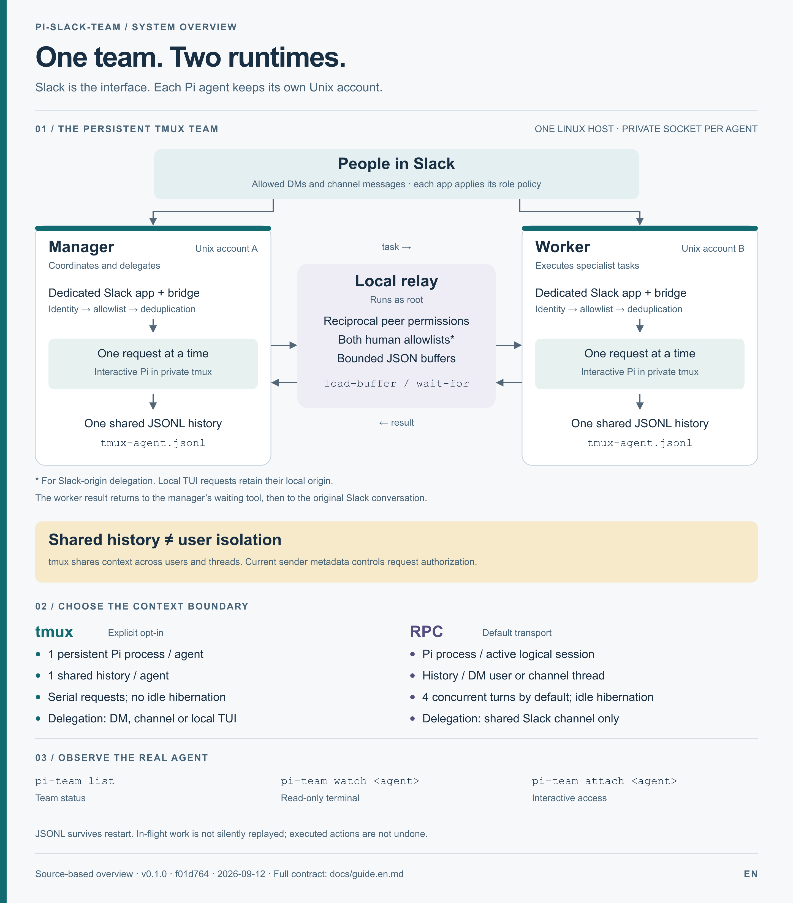

# pi-slack-team — project guide

[Українська](guide.uk.md) · [Documentation index](README.md) · [SVG infographic](assets/overview.en.svg) · [PNG infographic](assets/overview.en.png)

This guide describes version `0.1.0`, checked against the source on **2026-09-12** at commit `f01d764`. Configuration examples use synthetic identities. Deployment steps and acceptance checks below are instructions, not evidence that a server has been deployed or tested.

## 1. Purpose

`pi-slack-team` connects Slack to Pi coding agents. Each runtime has its own Slack app and non-root Unix account. A Slack request can invoke the tools and access the files available to that account. Agent instructions, model access and specialist integrations belong to the account's Pi configuration; the bridge does not install Jira, Oracle or other business tools.

There are two independent choices: **role** decides which Slack messages qualify; **transport** decides how Pi runs and how agents exchange work.



## 2. Roles and everyday use

| Incoming message | `worker` | `manager` |
| --- | --- | --- |
| Direct message from an allowed human | Executes a turn | Executes a turn |
| Explicit channel `@mention` from an allowed human | Executes a turn | Executes a turn |
| Allowed human reply in an engaged thread, without a mention | Executes a turn | Executes a turn |
| Other allowed human message in a joined channel | Ignored | Evaluated; may remain silent |
| Unauthorized human message | Rejected | Rejected |
| Ordinary bot message | Rejected | Rejected |

`worker` is the default. The first authorized human mention engages the agent in the thread. A tmux delegation creates an inactive worker thread marker: plain replies continue with the manager until a human explicitly mentions the worker. An existing active worker conversation stays active. RPC keeps its existing trusted-mention behavior. Later replies from allowed humans need no mention, including Pi dialog answers. Both roles need `message.channels` and `message.groups` subscriptions. Outside engaged threads, managers still evaluate ambient messages without publishing working/progress messages and can remain silent. Engagement survives restarts; existing worker channel conversations are engaged on upgrade. Legacy manager threads need a new mention because previous state did not record engagement.

Start with a concrete request in a DM or mention, for example: “Read the project README and explain how to run the checks.” Continue in the thread to retain reply routing. In tmux mode, a new thread still uses the agent's shared Pi history.

When Pi asks for a supported confirmation or selection, respond in the originating Slack conversation using the format shown by the bridge. In tmux mode the dialog belongs to the **current request sender**; in RPC it belongs to the **conversation owner**. Other users cannot answer it. Delegated dialogs cancel unless an exact configured `pi.autoSelect` rule authorizes that selection.

## 3. Choose the transport

| Property | `tmux` | `rpc` |
| --- | --- | --- |
| Enablement | Explicit `pi.transport: tmux` | Default if omitted |
| Pi runtime | One persistent interactive process per agent | Headless subprocess per active logical session |
| History | One shared history per agent | Per DM user; per channel thread |
| Simultaneous turns per agent | 1 | 4 by default; configurable up to 32 |
| Resident Pi processes | 1 | 8 by default; configurable up to 32 |
| Idle behavior | Pi remains running and observable | Process hibernates after 5 minutes by default |
| Manager → worker transport | Local relay between private tmux sockets | Private manager IPC, then correlated Slack messages |
| Delegation origin | DM, channel or local TUI | Shared channel thread only |
| Shared Slack channel required for delegation | No; both agents must be on the relay host and in the same configured workspace | Yes; both apps must have joined it |
| Operator observation | Existing terminal via `watch` | Logs and Slack progress |

Choose tmux when persistent, directly observable agents and shared context are appropriate. Choose RPC when separate DM-user/thread histories are required. RPC history separation does **not** isolate files or tools between sessions of the same Unix account; concurrent mutations of a shared working directory still need coordination.

**tmux does not isolate users' context.** Every request uses the same history. Current sender metadata guides authorization, but it is not a separate model-context boundary. Use separate agent accounts/apps where separate trust boundaries are required.

## 4. Architecture and request lifecycle

The identity chain is `agentId → Unix UID → Slack workspace/app`. Startup checks the effective user and private paths. Socket Mode receives events; the runtime validates workspace, receiving app, conversation type, sender, subtype and file limits before dispatching work.

1. The Slack bridge receives and acknowledges the event.
2. Authorization filters it; SQLite claims the event ID so a retry cannot allocate the same turn again.
3. Slack routing records retain `(team_id, app_id, channel_id, thread_ts)`. A root message uses its own timestamp as `thread_ts`.
4. Each serialized thread turn receives fresh history after the last successfully incorporated timestamp, marked as untrusted: up to 200 messages and 50,000 characters. New sessions bootstrap prior history. The current request and this agent's output are excluded. Preparation, execution and final delivery stay in arrival order; dialog replies bypass the queue.
5. The selected runner queues work. RPC serializes each logical session and applies a global concurrency limit. tmux serializes the agent's requests through named JSON buffers and `wait-for` wakeups.
6. Pi runs with that Unix account's instructions, tools and permissions. Explicit requests receive bounded progress; final text is sent to the originating Slack conversation.
7. Pi JSONL stores history. RPC can stop an idle process and resume later. tmux keeps the interactive process alive while the service is running.

In tmux, conversations bind to `agent:<team>:<app>`. The session name is `expectedUnixUser`, its window is `pi`, and the history file is `<pi.sessionDir>/tmux-agent.jsonl`. Legacy histories remain on disk and are not automatically merged.

### Delegation

With reciprocal `interAgent.peers`, a manager can call `delegate_to_worker`. In tmux, a root-run local relay moves bounded JSON buffers between fixed private sockets. It checks role direction, reciprocal configured agent/app identities, workspace and deadlines; Slack-origin work also requires the human in **both** agents' allowlists. `botUserId` remains required by the shared configuration schema; RPC uses it to authenticate Slack bot events. tmux uses the configured socket identity rather than a bot event as its transport boundary.

Since **0.4.1**, a tmux worker appears in the original thread **as its own Slack App**, using its existing credentials. It acknowledges “Отримав завдання від менеджера. Очікую черги” before submission; “Виконую” starts only when Pi accepts the request. Its console stream retains commentary, tool invocations, ten-line result previews and the final answer. The manager receives the result through the existing tool and adds its own summary; its delegation tool card shows worker status instead of repeating the result.

In a manager DM, or if the worker cannot post its initial acknowledgement to the channel, the manager publishes a **worker-labelled stream** there. No bot is automatically invited and no new OAuth scope or configuration is required. Channel membership follows [Slack's posting rules](https://docs.slack.dev/reference/methods/chat.postMessage/#channels). An uncertain initial post is not repeated; a later delivery failure preserves shown entries and reports the interruption while the manager retains the result. Local TUI delegations without Slack origin stay local. Explicit legacy output modes and RPC remain supported.

Child output uses correlated parent-run/tool-call IDs and immutable sequenced packets, acknowledged only after renderer state is persisted. The relay delivers them directly to the Slack renderer, bypassing the model; the worker result waits for the final event acknowledgement. Publication route, message timestamps, consumed sequence and delivery state survive bridge restarts in private SQLite. Recovery does not replay tools or blindly retry an uncertain post. All delegated writes share the existing queue and honor the complete [Retry-After](https://docs.slack.dev/apis/web-api/rate-limits/).

The worker executes in its own account and returns a correlated result to the manager's waiting tool. This does not create another manager turn. Nested delegation is disabled in managed tmux agents. The relay transports buffers, not arbitrary terminal commands or simulated keystrokes. `team_status` reads recent relay status; stale or missing status does not prove availability.

RPC instead sends authenticated, correlated bot envelopes in the same shared Slack thread. Its manager wait is memory-only; a runtime restart interrupts it. Configuring an RPC manager peer grants that bot delegation authority, so keep reciprocal peers narrow.

### Storage and source map

| Component / data | Location | Responsibility |
| --- | --- | --- |
| Runtime entry point | [`src/main.ts`](../src/main.ts) | Select runner, start bridge, handle shutdown and health |
| Configuration | [`src/config/schema.ts`](../src/config/schema.ts) | Strict keys, defaults and bounds |
| Authorization / routing | [`src/routing/chat-service.ts`](../src/routing/chat-service.ts) | Human/peer policy, deduplication and dispatch |
| Slack bridge | [`src/slack/slack-bridge.ts`](../src/slack/slack-bridge.ts) | Context, progress, replies and interactive UI |
| RPC runner | [`src/pi/session-pool.ts`](../src/pi/session-pool.ts) | Per-session queue, process limits and hibernation |
| tmux runner / extension | [`src/tmux/agent-runner.ts`](../src/tmux/agent-runner.ts), [`agent-extension.ts`](../src/tmux/agent-extension.ts) | One Pi session, serial execution, UI and receipts |
| tmux relay / mailbox | [`src/tmux/relay.ts`](../src/tmux/relay.ts), [`mailbox.ts`](../src/tmux/mailbox.ts) | Cross-account policy and bounded buffer transport |
| SQLite registry | `<stateDir>/state.sqlite` | Routing, event IDs, session references and interaction metadata |
| Pi history | `pi.sessionDir` | Persistent JSONL conversation history |
| tmux receipts | `<stateDir>/tmux-receipts/` | Execution receipts/results; seven-day retention |
| Slack downloads | Below `stateDir` | Optional private files, mode `0600` |

SQLite is not a credential store. History, receipts, downloads and routing metadata can still be sensitive. Back them up privately.

## 5. Configuration

Use the matching checked-in example; replace every synthetic ID and path outside the repository:

| Role | tmux | RPC |
| --- | --- | --- |
| Manager | [`tmux-manager.example.yaml`](../config/tmux-manager.example.yaml) | [`manager.example.yaml`](../config/manager.example.yaml) |
| Worker | [`tmux-worker.example.yaml`](../config/tmux-worker.example.yaml) | [`worker.example.yaml`](../config/worker.example.yaml) |

The YAML schema rejects unknown keys. Required top-level fields are `version: 1`, `agentId`, `expectedUnixUser`, `stateDir`, `slack` and `pi`. `role` defaults to `worker`. `agentId` is 2–63 lowercase letters/digits/hyphens and begins with a letter.

`slack.teamId`, `slack.appId` and a non-empty `slack.allowedUserIds` are mandatory. `pi.cwd`, `pi.agentDir` and `pi.sessionDir` are absolute paths. `stateDir` and `agentDir` must be inside the effective user's home; `sessionDir` must be inside `agentDir`. `cwd` must exist and `pi.command` must be executable.

| Setting | Default | Meaning / bound |
| --- | --- | --- |
| `pi.transport` | `rpc` | `rpc` or `tmux` |
| `pi.command` | `/usr/bin/pi` | Absolute Pi executable |
| `pi.tmuxCommand` | `/usr/local/bin/tmux` | Absolute tmux executable; tmux mode requires 3.5+ |
| `pi.turnTimeoutMs` | `3600000` | tmux request including queue time; 10 seconds–24 hours |
| `pi.requestTimeoutMs` | `30000` | RPC request bound; tmux startup allows at least 90 seconds |
| `pi.maxConcurrentTurns` | `4` in RPC | 1–32; forced to 1 in tmux |
| `pi.maxResidentProcesses` | `8` in RPC | At least the concurrent-turn limit, at most 32; forced to 1 in tmux |
| `pi.idleTimeoutMs` | `300000` | RPC hibernation; unused in tmux |
| `pi.autoSelect` | `[]` | Up to 16 exact title/option standing authorizations |
| `slack.progressMode` | `console` | Persistent Pi text and compact tool results; explicit `summary` / `raw` remain supported |
| `slack.fileUploads` | `false` | Download authorized attachments only when enabled |
| `slack.maxFileBytes` | `20971520` | 20 MiB per file; maximum 100 MiB |
| `slack.maxFilesPerMessage` | `5` | Maximum 10 |
| `slack.uploadRetentionDays` | `7` | Downloaded attachments older than this are deleted; 1–365 |
| `interAgent.requestTimeoutMs` | `900000` | Delegation including queue time; 10 seconds–1 hour |
| `interAgent.maxTaskChars` | `30000` | Maximum 37,000 |
| `interAgent.maxResponseChars` | `50000` | Maximum 100,000 |

The deprecated `pi.maxActiveSessions` supplies the RPC concurrency limit only when `maxConcurrentTurns` is absent. tmux admits at most 128 bridge requests at once, including active work, and a separate queue of up to 32 local inputs typed during remote work. A tmux buffer is limited to 1 MiB.

Omit `interAgent` to disable delegation. Otherwise configure 1–32 reciprocal, opposite-role peers with unique `agentId`, `appId` and `botUserId`. Never list the runtime's own app as a peer.

Production Slack credentials are read from `$CREDENTIALS_DIRECTORY/slack_bot_token` and `$CREDENTIALS_DIRECTORY/slack_app_token`, supplied by systemd `LoadCredential`. For local development, the optional `credentials.botTokenFile` and `credentials.appTokenFile` point to private absolute files. Model credentials remain with the agent's Pi configuration.

## 6. Install and start

Production isolation uses Linux, systemd and one dedicated non-root Unix account per agent. The package requires Node.js **24+** and declares **pnpm 11.17.0**. Install Pi at the configured absolute path; tmux mode also requires **tmux 3.5+**. See [`package.json`](../package.json) for pinned application dependencies.

From a checkout with the declared pnpm version available:

```bash
pnpm install --frozen-lockfile --ignore-scripts
pnpm check
pnpm build
```

1. Create one Slack app per agent using the [worker manifest](../manifests/worker-agent.example.yaml) or [manager manifest](../manifests/manager-agent.example.yaml). Enable Socket Mode, create an app-level token with `connections:write`, and install the app to obtain its bot token.
2. Invite the app to the channels it should serve. Verify manager ambient event subscriptions separately from mentions. Add `files:read` and reinstall only if file downloads are enabled.
3. Provision the dedicated account, working directory and Pi configuration. Verify its model access and tools under that account.
4. Place private machine configuration at `/etc/pi-slack-team/<unix-user>.yaml`. Store credentials under `/etc/pi-slack-team/credentials/<unix-user>/`. An owner-only provisioning `.env` containing exactly `SLACK_APP_TOKEN` and `SLACK_BOT_TOKEN` can be imported with [`deploy/import-env-credentials.mjs`](../deploy/import-env-credentials.mjs); the importer does not print values or overwrite different credentials.
5. Deploy the built release and dependencies under `/opt/pi-slack-team/current/`, including `deploy/tmux.conf` for tmux mode. Install [`pi-slack-team@.service`](../deploy/systemd/pi-slack-team@.service) in `/etc/systemd/system/` and review paths for the host.
6. Run `doctor` as the configured agent with readable credentials. It checks identity/path constraints, credential loading and executable versions. It does **not** test Slack connectivity, model access, tool behavior or a complete delegation.
7. Start one service instance and complete the acceptance checks before expanding the rollout. For tmux delegation, also install and start [`pi-tmux-relay.service`](../deploy/systemd/pi-tmux-relay.service). The relay runs as root and reads root-owned, non-group/world-writable `.yaml` files in `/etc/pi-slack-team`; keep that directory root-managed too.

For local credential-file configuration, run as the matching Unix account:

```bash
node dist/main.js doctor --config /absolute/private/path/agent.yaml
node dist/main.js start --config /absolute/private/path/agent.yaml
```

An ordinary shell does not automatically receive systemd credentials. For a production doctor check, root can launch a transient unit with the same credential inputs, replacing `pi-worker` with the configured account:

```bash
systemd-run --wait --pipe --collect --uid=pi-worker \
  --property=WorkingDirectory=/home/pi-worker \
  --setenv=HOME=/home/pi-worker \
  --property=LoadCredential=slack_bot_token:/etc/pi-slack-team/credentials/pi-worker/slack_bot_token \
  --property=LoadCredential=slack_app_token:/etc/pi-slack-team/credentials/pi-worker/slack_app_token \
  /usr/bin/node /opt/pi-slack-team/current/dist/main.js doctor \
  --config /etc/pi-slack-team/pi-worker.yaml

systemctl daemon-reload
systemctl enable --now pi-slack-team@pi-worker.service
systemctl enable --now pi-tmux-relay.service
```

The last command is for tmux teams using the relay. `PI_TEAM_CONFIG_DIR` selects a different configuration directory for the team CLI; a custom relay service must receive the same setting.

## 7. Observe and operate

`pi-team` is an operator wrapper, **not** an automatically installed package executable. Create `/usr/local/bin/pi-team` with this content and make it executable:

```sh
#!/bin/sh
exec /usr/bin/node /opt/pi-slack-team/current/dist/tmux/cli.js "$@"
```

Run as root for the whole team, or as the matching agent for its accessible configuration/socket:

```bash
pi-team list
pi-team watch pi-worker
pi-team attach pi-worker
pi-team capture pi-worker
journalctl -u pi-slack-team@pi-worker.service -n 100 --no-pager
journalctl -u pi-tmux-relay.service -n 100 --no-pager
```

`watch` is read-only; `attach` can change or cancel work. Both use the existing session. Detach with **Ctrl+b, then d**; Pi keeps running. `capture` returns the last 200 terminal lines. Terminal views may reveal tool output and model thinking, so handle captures privately. Slack does not receive private thinking blocks.

`list` reports `idle`, `busy`, `stale` or `offline`. `offline` can also mean the socket is unreadable by the caller. The heartbeat becomes stale after 15 seconds; the bridge checks health every 5 seconds and exits on failure so systemd can restart it. The persistent JSONL survives a process restart; an in-flight task is not silently replayed.

## 8. Failures, restart and rollback

| Symptom | Check / response |
| --- | --- |
| Manager mentions work, ordinary messages do not | Check `role`, both ambient subscriptions, channel membership and human allowlist |
| tmux agent offline/stale | Check service journal, configured socket, user permissions and interactive Pi startup |
| Delegation rejected | Check reciprocal identities, role direction, same workspace, both human allowlists for tmux, task bounds and deadline |
| RPC delegation unavailable in DM | Use a shared channel with both apps, or deliberately choose tmux |
| Confirmation ignored | Check sender/owner rule, original thread, request ID and expiry |
| Attachments rejected | Check `fileUploads`, `files:read`, count/byte limits and Slack file URL |
| Task times out | Inspect actual artifacts and external effects before retrying; queue time counts in tmux/delegation deadlines |
| Slack remains disconnected | Inspect connection logs; after a two-minute recovery window the runtime exits for systemd restart |

The default `console` stream retains assistant messages, tool calls and results in order. The current entry updates live; completed entries remain visible and the final answer is not duplicated. Tool previews show the first 10 lines and the number hidden, with a command/path and execution state. Terminal controls and private thinking are excluded. RPC and tmux share this behavior. Long text preserves code fences. Slack writes are serialized, throttled and respect the complete `Retry-After`; delivery failure never repeats tools.

Existing configurations explicitly selecting `summary` or `raw` retain their previous rendering. Change them to `console` to use the new output; the default applies when the setting is absent. Update the Slack App event subscriptions as well. Bridge and managed tmux extension must be updated together; restart the managed Pi process to load the new event transport. No live Slack App, server configuration or deployment is changed by editing these examples.

In `summary`, ordinary partial tool output is hidden; strictly validated `PI_DEPLOY_PROGRESS` markers can provide bounded deployment counters. If Slack rejects raw progress, the turn retries with summary progress. Final text is posted separately.

Before maintenance, stop admitting new work and verify the agents are idle. Stop affected services before copying SQLite files. Record the release target; back up YAML, units, SQLite including any WAL/SHM companions, and Pi histories to a private location outside Git. tmux's Pi process remains alive while idle, so **process existence alone is not evidence of active work**.

Switching RPC → tmux lazily rebinds conversations to shared history; it does not merge old histories. To roll back that migration, stop the relay and affected agents, restore the prior release/configuration **and backed-up SQLite state**, then restart the previous services. Replace/remove WAL/SHM only while stopped. Restoring YAML alone does not undo shared-session bindings. Retain the newer JSONL for audit.

A relay restart can recover correlation from buffers while the tmux servers survive. A tmux server or host restart loses in-flight buffers. Receipts are written before execution to prevent automatic replay of interrupted tools; saved results may satisfy completed duplicate deliveries. Cancellation and rollback do **not** undo executed tools, spawned jobs or external changes.

## 9. Security boundaries and limitations

- An allowed Slack user can exercise the agent account's tool/OS permissions. Keep account privileges and peer lists appropriate to the work.
- tmux shares history across users and threads. RPC separates histories but shares the account's filesystem and credentials.
- Thread history is untrusted context. Treat sender metadata supplied by the runtime separately from claims inside message text.
- `console` (the default) and `raw` expose tool arguments/output to readers of the Slack thread. Select `summary` to hide tool details.
- `autoSelect` matches the whole title and an available option. It never authorizes confirmations, regex/prefix matches or missing options; each rule is standing permission.
- The managed tmux pane blocks hidden `subagent` tools and session switching/forking. Local operator access remains privileged and can affect running work.
- The project is pre-1.0. There is no high availability for one Slack app connection, no per-chat Git worktree isolation and no Slack Connect authorization model.

See the [security policy](../SECURITY.md) and [tmux contract](tmux-team.md) for further detail.

## 10. Verification and maintenance

The repository's `pnpm check` runs lint, TypeScript checks and tests. `pnpm build` creates `dist/`. Run both for a release; a successful local check is not a live deployment acceptance result.

Before accepting a deployment, verify:

1. One expected app/account identity and one authorized DM response; unauthorized humans and ordinary bots cannot start work.
2. After one mention, an allowed participant can continue the thread without mentioning again, including after restart. Unrelated worker threads stay ignored; ambient manager observations can remain silent.
3. Check retained commentary → tool → result → final output, a 10-line tool preview and dialog replies without mentions.
4. Duplicate delivery does not execute twice; an existing history resumes after an idle restart.
5. For tmux: one process/session per agent; different humans' requests serialize; UI belongs to the current sender; `watch` observes the same terminal.
6. A harmless manager → worker task returns to the original waiting tool. For tmux, also test a DM origin and both allowlists. For RPC, use the shared channel.
7. Offline worker, timeout, invalid peer and interrupted request produce an explicit failure without silently replaying tools. Use only harmless work for interruption tests.

Relevant tests: [`tmux.test.ts`](../test/tmux.test.ts), [`chat-service.test.ts`](../test/chat-service.test.ts), [`session-pool.test.ts`](../test/session-pool.test.ts), [`inter-agent-gateway.test.ts`](../test/inter-agent-gateway.test.ts), [`slack-ui.test.ts`](../test/slack-ui.test.ts), [`config.test.ts`](../test/config.test.ts).

When behavior changes, update the same numbered section in the [Ukrainian guide](guide.uk.md), both infographics and affected detailed references.
