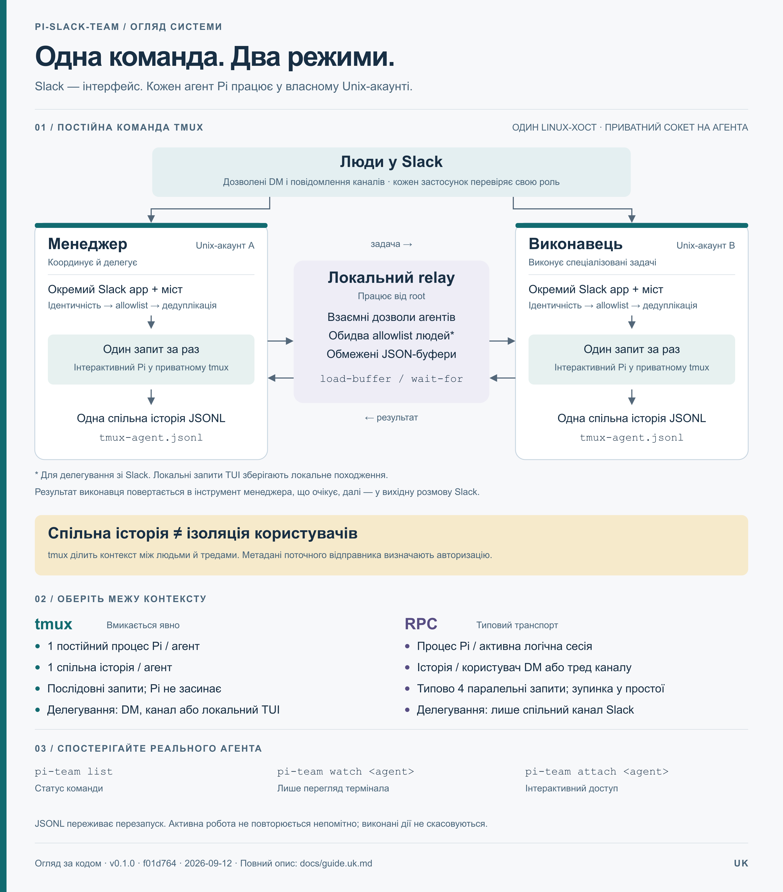

# pi-slack-team — посібник проєкту

[English](guide.en.md) · [Зміст документації](README.md) · [Інфографіка SVG](assets/overview.uk.svg) · [Інфографіка PNG](assets/overview.uk.png)

Посібник описує версію `0.1.0`, звірену з кодом **2026-09-12** на коміті `f01d764`. Приклади конфігурації використовують вигадані ідентифікатори. Наведені кроки розгортання й приймальні перевірки є інструкціями, а не доказом, що сервер уже розгорнуто чи перевірено.

## 1. Призначення

`pi-slack-team` з’єднує Slack з агентами програмування Pi. Кожен runtime має окремий Slack app і непривілейований Unix-акаунт. Запит зі Slack може викликати інструменти й читати файли, доступні цьому акаунту. Інструкції агента, доступ до моделей і спеціалізовані інтеграції належать конфігурації Pi відповідного акаунта; міст не встановлює Jira, Oracle чи інші бізнес-інструменти.

Є два незалежні налаштування: **роль** визначає, які повідомлення Slack обробляти; **транспорт** — як запускати Pi та передавати роботу між агентами.



## 2. Ролі та щоденне використання

| Вхідне повідомлення | `worker` | `manager` |
| --- | --- | --- |
| Особисте повідомлення від дозволеної людини | Виконує запит | Виконує запит |
| Явна `@згадка` в каналі від дозволеної людини | Виконує запит | Виконує запит |
| Звичайне повідомлення дозволеної людини в приєднаному каналі | Ігнорує | Оцінює; може промовчати |
| Повідомлення недозволеної людини | Відхиляє | Відхиляє |
| Звичайне повідомлення бота | Відхиляє | Відхиляє |

За замовчуванням роль — `worker`. Виконавцю потрібна явна згадка в **кожному** зверненні в каналі, зокрема у відповідях наявного треду. Менеджеру додатково потрібні підписки `message.channels` і `message.groups` для звичайних повідомлень публічних та приватних каналів. Їх оцінювання витрачає один запит до Pi, але не публікує повідомлень про початок чи прогрес; рішення промовчати не створює відповіді у Slack.

Почніть із конкретного запиту в особистому повідомленні або зі згадкою, наприклад: «Прочитай README проєкту й поясни, як запустити перевірки». Продовжуйте в треді, щоб зберегти маршрут відповідей. У режимі tmux новий тред також використовує спільну історію Pi цього агента.

Коли Pi запитує підтримуване підтвердження або вибір, відповідайте у вихідній розмові Slack у форматі, який показує міст. У tmux діалог належить **поточному відправнику запиту**; у RPC — **власнику розмови**. Інші користувачі не можуть відповісти на нього. Діалоги делегованої роботи скасовуються, якщо точне правило `pi.autoSelect` не дозволяє відповідний вибір.

## 3. Вибір транспорту

| Властивість | `tmux` | `rpc` |
| --- | --- | --- |
| Увімкнення | Явне `pi.transport: tmux` | Типове значення, якщо поле відсутнє |
| Виконання Pi | Один постійний інтерактивний процес на агента | Фоновий підпроцес на активну логічну сесію |
| Історія | Одна спільна історія на агента | Окрема для користувача в DM; окрема для треду каналу |
| Одночасні запити на агента | 1 | Типово 4; налаштовується до 32 |
| Резидентні процеси Pi | 1 | Типово 8; налаштовується до 32 |
| Простій | Pi працює далі й доступний для спостереження | Процес зупиняється типово після 5 хвилин простою |
| Транспорт manager → worker | Локальний relay між приватними сокетами tmux | Приватний IPC менеджера, далі корельовані повідомлення Slack |
| Джерело делегування | DM, канал або локальний TUI | Лише тред спільного каналу |
| Спільний канал Slack для делегування | Не потрібен; обидва агенти мають бути на хості relay та в одному налаштованому workspace | Потрібен; обидва застосунки мають бути в ньому |
| Спостереження оператора | Наявний термінал через `watch` | Журнали й прогрес у Slack |

Обирайте tmux, коли потрібні постійні агенти з доступним для спостереження терміналом і прийнятним спільним контекстом. Обирайте RPC, коли потрібні окремі історії користувачів DM і тредів. Розділення історій RPC **не** ізолює файли чи інструменти між сесіями одного Unix-акаунта; одночасні зміни спільного робочого каталогу потребують координації.

**tmux не ізолює контекст користувачів.** Кожен запит використовує ту саму історію. Метадані поточного відправника визначають авторизацію, але не створюють окремої межі контексту моделі. Для окремих меж довіри використовуйте різні акаунти й застосунки агентів.

## 4. Архітектура та життєвий цикл запиту

Ланцюжок ідентичності: `agentId → Unix UID → Slack workspace/app`. Під час запуску перевіряються фактичний користувач і приватні шляхи. Socket Mode отримує події; до передавання роботи runtime перевіряє workspace, застосунок-одержувач, тип розмови, відправника, підтип події та ліміти файлів.

1. Міст Slack отримує подію й підтверджує доставлення.
2. Авторизація відфільтровує її; SQLite реєструє ID події, щоб повторне доставлення не створило той самий запит ще раз.
3. Записи маршрутизації Slack зберігають `(team_id, app_id, channel_id, thread_ts)`. Кореневе повідомлення використовує власний timestamp як `thread_ts`.
4. Нова прив’язка розмови/сесії отримує обмежений попередній контекст треду з позначкою недовірених даних: до 200 повідомлень і 50 000 символів. Поточний запит залишається окремо.
5. Обраний runner ставить роботу в чергу. RPC послідовно виконує запити кожної логічної сесії та застосовує загальний ліміт паралельності. tmux послідовно виконує запити агента через іменовані JSON-буфери й сигнали `wait-for`.
6. Pi працює з інструкціями, інструментами й правами цього Unix-акаунта. Явні запити отримують обмежений прогрес; фінальний текст надсилається у вихідну розмову Slack.
7. Pi зберігає історію у JSONL. RPC може зупинити неактивний процес і відновити його пізніше. tmux зберігає інтерактивний процес, доки працює сервіс.

У tmux розмови прив’язуються до `agent:<team>:<app>`. Назва сесії — `expectedUnixUser`, її вікно — `pi`, файл історії — `<pi.sessionDir>/tmux-agent.jsonl`. Попередні історії залишаються на диску й не об’єднуються автоматично.

### Делегування

За взаємних налаштувань `interAgent.peers` менеджер може викликати `delegate_to_worker`. У tmux локальний relay від root переносить обмежені JSON-буфери між фіксованими приватними сокетами. Він перевіряє напрямок ролей, взаємно налаштовані ідентичності агентів/застосунків, workspace і строки; для роботи зі Slack людина також має бути в allowlist **обох** агентів. `botUserId` залишається обов’язковим у спільній схемі конфігурації; RPC використовує його для автентифікації подій ботів Slack. У tmux транспортна межа спирається на налаштовану ідентичність сокета, а не на подію бота.

Виконавець працює у власному акаунті й повертає корельований результат інструменту менеджера, що очікує. Це не створює нового запиту до менеджера. Вкладене делегування у керованих tmux-агентах вимкнене. Relay передає буфери, а не довільні команди термінала чи імітовані натискання клавіш. `team_status` читає свіжий статус relay; застарілий або відсутній статус не доводить доступності агента.

RPC натомість передає автентифіковані корельовані повідомлення ботів у тому самому спільному треді Slack. Очікування менеджера існує лише в пам’яті; перезапуск runtime перериває його. Налаштування manager peer у RPC надає цьому боту право делегувати, тому список взаємно довірених агентів має бути вузьким.

### Сховище та карта коду

| Компонент / дані | Розташування | Відповідальність |
| --- | --- | --- |
| Точка входу runtime | [`src/main.ts`](../src/main.ts) | Вибір runner, запуск мосту, завершення й контроль працездатності |
| Конфігурація | [`src/config/schema.ts`](../src/config/schema.ts) | Суворі ключі, типові значення й межі |
| Авторизація / маршрутизація | [`src/routing/chat-service.ts`](../src/routing/chat-service.ts) | Політика людей/агентів, дедуплікація й передавання запитів |
| Міст Slack | [`src/slack/slack-bridge.ts`](../src/slack/slack-bridge.ts) | Контекст, прогрес, відповіді та інтерактивні діалоги |
| RPC runner | [`src/pi/session-pool.ts`](../src/pi/session-pool.ts) | Черга сесії, ліміти процесів і зупинка під час простою |
| tmux runner / розширення | [`src/tmux/agent-runner.ts`](../src/tmux/agent-runner.ts), [`agent-extension.ts`](../src/tmux/agent-extension.ts) | Одна сесія Pi, послідовне виконання, діалоги й квитанції |
| tmux relay / mailbox | [`src/tmux/relay.ts`](../src/tmux/relay.ts), [`mailbox.ts`](../src/tmux/mailbox.ts) | Політика між акаунтами й обмежене передавання буферів |
| Реєстр SQLite | `<stateDir>/state.sqlite` | Маршрутизація, ID подій, посилання на сесії й метадані взаємодії |
| Історія Pi | `pi.sessionDir` | Постійна історія розмов у JSONL |
| Квитанції tmux | `<stateDir>/tmux-receipts/` | Квитанції/результати виконання; зберігання сім днів |
| Завантаження зі Slack | Усередині `stateDir` | Необов’язкові приватні файли, режим `0600` |

SQLite не є сховищем облікових даних. Історія, квитанції, завантаження й метадані маршрутизації все одно можуть містити чутливі дані. Резервні копії мають бути приватними.

## 5. Конфігурація

Використовуйте відповідний приклад із репозиторію; замініть усі вигадані ID та шляхи поза репозиторієм:

| Роль | tmux | RPC |
| --- | --- | --- |
| Менеджер | [`tmux-manager.example.yaml`](../config/tmux-manager.example.yaml) | [`manager.example.yaml`](../config/manager.example.yaml) |
| Виконавець | [`tmux-worker.example.yaml`](../config/tmux-worker.example.yaml) | [`worker.example.yaml`](../config/worker.example.yaml) |

Схема YAML відхиляє невідомі ключі. Обов’язкові поля верхнього рівня: `version: 1`, `agentId`, `expectedUnixUser`, `stateDir`, `slack` і `pi`. Типове значення `role` — `worker`. `agentId` містить 2–63 малі латинські літери, цифри або дефіси й починається з літери.

`slack.teamId`, `slack.appId` і непорожній `slack.allowedUserIds` обов’язкові. `pi.cwd`, `pi.agentDir` і `pi.sessionDir` — абсолютні шляхи. `stateDir` та `agentDir` мають бути всередині домашнього каталогу фактичного користувача; `sessionDir` — усередині `agentDir`. `cwd` має існувати, а `pi.command` — бути виконуваним файлом.

| Налаштування | Типове значення | Значення / межа |
| --- | --- | --- |
| `pi.transport` | `rpc` | `rpc` або `tmux` |
| `pi.command` | `/usr/bin/pi` | Абсолютний шлях до Pi |
| `pi.tmuxCommand` | `/usr/local/bin/tmux` | Абсолютний шлях до tmux; режим tmux потребує 3.5+ |
| `pi.turnTimeoutMs` | `3600000` | Запит tmux разом із часом у черзі; 10 секунд–24 години |
| `pi.requestTimeoutMs` | `30000` | Межа запиту RPC; запуск tmux отримує щонайменше 90 секунд |
| `pi.maxConcurrentTurns` | `4` у RPC | 1–32; примусово 1 у tmux |
| `pi.maxResidentProcesses` | `8` у RPC | Не менше ліміту паралельних запитів, не більше 32; примусово 1 у tmux |
| `pi.idleTimeoutMs` | `300000` | Зупинка RPC під час простою; не використовується у tmux |
| `pi.autoSelect` | `[]` | До 16 постійних дозволів із точним збігом заголовка/варіанта |
| `slack.progressMode` | `summary` | `raw` також показує обмежені аргументи/результати інструментів |
| `slack.fileUploads` | `false` | Завантажувати дозволені вкладення лише після увімкнення |
| `slack.maxFileBytes` | `20971520` | 20 MiB на файл; максимум 100 MiB |
| `slack.maxFilesPerMessage` | `5` | Максимум 10 |
| `slack.uploadRetentionDays` | `7` | Завантажені вкладення, старші за цей строк, видаляються; 1–365 |
| `interAgent.requestTimeoutMs` | `900000` | Делегування разом із часом у черзі; 10 секунд–1 година |
| `interAgent.maxTaskChars` | `30000` | Максимум 37 000 |
| `interAgent.maxResponseChars` | `50000` | Максимум 100 000 |

Застарілий `pi.maxActiveSessions` задає паралельність RPC лише за відсутності `maxConcurrentTurns`. tmux допускає щонайбільше 128 запитів мосту одночасно, включно з активною роботою, та окрему чергу до 32 локальних повідомлень, введених під час віддаленої роботи. Один буфер tmux обмежений 1 MiB.

Приберіть `interAgent`, щоб вимкнути делегування. Інакше налаштуйте 1–32 взаємно довірених агенти протилежної ролі з унікальними `agentId`, `appId` і `botUserId`. Не додавайте власний застосунок runtime як peer.

Облікові дані Slack у production читаються з `$CREDENTIALS_DIRECTORY/slack_bot_token` та `$CREDENTIALS_DIRECTORY/slack_app_token`, наданих через systemd `LoadCredential`. Для локальної розробки необов’язкові `credentials.botTokenFile` і `credentials.appTokenFile` вказують на приватні абсолютні файли. Облікові дані моделей залишаються у конфігурації Pi агента.

## 6. Встановлення й запуск

Production-ізоляція використовує Linux, systemd та окремий непривілейований Unix-акаунт на агента. Пакет потребує Node.js **24+** і декларує **pnpm 11.17.0**. Установіть Pi за налаштованим абсолютним шляхом; режим tmux також потребує **tmux 3.5+**. Зафіксовані залежності застосунку наведено в [`package.json`](../package.json).

У каталозі репозиторію з доступною задекларованою версією pnpm:

```bash
pnpm install --frozen-lockfile --ignore-scripts
pnpm check
pnpm build
```

1. Створіть окремий Slack app на агента з [маніфесту worker](../manifests/worker-agent.example.yaml) або [маніфесту manager](../manifests/manager-agent.example.yaml). Увімкніть Socket Mode, створіть app-level token із `connections:write` та встановіть застосунок, щоб отримати bot token.
2. Запросіть застосунок у канали, які він має обслуговувати. Окремо від згадок перевірте підписки менеджера на звичайні повідомлення. Додавайте `files:read` і перевстановлюйте застосунок лише якщо увімкнено завантаження файлів.
3. Підготуйте окремий акаунт, робочий каталог і конфігурацію Pi. Перевірте доступ до моделей та інструментів під цим акаунтом.
4. Розмістіть приватну конфігурацію хоста в `/etc/pi-slack-team/<unix-user>.yaml`. Зберігайте облікові дані в `/etc/pi-slack-team/credentials/<unix-user>/`. Підготовлений `.env`, доступний лише власнику й такий, що містить тільки `SLACK_APP_TOKEN` та `SLACK_BOT_TOKEN`, можна імпортувати через [`deploy/import-env-credentials.mjs`](../deploy/import-env-credentials.mjs); імпортер не друкує значень і не перезаписує інші облікові дані.
5. Розгорніть зібраний реліз і залежності в `/opt/pi-slack-team/current/`, включно з `deploy/tmux.conf` для tmux. Установіть [`pi-slack-team@.service`](../deploy/systemd/pi-slack-team@.service) в `/etc/systemd/system/` та звірте шляхи з хостом.
6. Запустіть `doctor` як налаштований агент із доступними обліковими даними. Він перевіряє ідентичність/обмеження шляхів, завантаження облікових даних і версії виконуваних файлів. Він **не** перевіряє з’єднання зі Slack, доступ до моделі, поведінку інструментів чи повне делегування.
7. Запустіть один екземпляр сервісу й виконайте приймальні перевірки перед розширенням розгортання. Для делегування через tmux також установіть і запустіть [`pi-tmux-relay.service`](../deploy/systemd/pi-tmux-relay.service). Relay працює від root і читає `.yaml` у `/etc/pi-slack-team`, які належать root та недоступні для запису групі/іншим; сам каталог також має керуватися root.

Для локальної конфігурації з файлами облікових даних запускайте під відповідним Unix-акаунтом:

```bash
node dist/main.js doctor --config /absolute/private/path/agent.yaml
node dist/main.js start --config /absolute/private/path/agent.yaml
```

Звичайна оболонка не отримує облікові дані systemd автоматично. Для production-перевірки doctor користувач root може запустити тимчасовий unit із тими самими джерелами облікових даних, замінивши `pi-worker` на налаштований акаунт:

```bash
systemd-run --wait --pipe --collect --uid=pi-worker \
  --property=WorkingDirectory=/home/pi-worker \
  --setenv=HOME=/home/pi-worker \
  --property=LoadCredential=slack_bot_token:/etc/pi-slack-team/credentials/pi-worker/slack_bot_token \
  --property=LoadCredential=slack_app_token:/etc/pi-slack-team/credentials/pi-worker/slack_app_token \
  /usr/bin/node /opt/pi-slack-team/current/dist/main.js doctor \
  --config /etc/pi-slack-team/pi-worker.yaml

systemctl daemon-reload
systemctl enable --now pi-slack-team@pi-worker.service
systemctl enable --now pi-tmux-relay.service
```

Остання команда призначена для tmux-команд, що використовують relay. `PI_TEAM_CONFIG_DIR` обирає інший каталог конфігурації для CLI команди; окремий сервіс relay має отримати те саме налаштування.

## 7. Спостереження й експлуатація

`pi-team` — обгортка для оператора, а **не** виконуваний файл, який пакет встановлює автоматично. Створіть `/usr/local/bin/pi-team` із таким вмістом і надайте право виконання:

```sh
#!/bin/sh
exec /usr/bin/node /opt/pi-slack-team/current/dist/tmux/cli.js "$@"
```

Запускайте від root для всієї команди або від відповідного агента для доступних йому конфігурації/сокета:

```bash
pi-team list
pi-team watch pi-worker
pi-team attach pi-worker
pi-team capture pi-worker
journalctl -u pi-slack-team@pi-worker.service -n 100 --no-pager
journalctl -u pi-tmux-relay.service -n 100 --no-pager
```

`watch` лише спостерігає; `attach` може змінювати чи скасовувати роботу. Обидві команди використовують наявну сесію. Від’єднання — **Ctrl+b, потім d**; Pi продовжує працювати. `capture` повертає останні 200 рядків термінала. Термінал може показувати результати інструментів і міркування моделі, тому зберігайте знімки приватно. Slack не отримує приватних блоків міркувань.

`list` показує `idle`, `busy`, `stale` або `offline`. `offline` також може означати, що викликач не має доступу до сокета. Heartbeat стає застарілим після 15 секунд; міст перевіряє працездатність кожні 5 секунд і завершується за помилки, щоб systemd міг його перезапустити. Постійний JSONL переживає перезапуск процесу; активна задача не повторюється непомітно.

## 8. Збої, перезапуск і відкат

| Симптом | Перевірка / дія |
| --- | --- |
| Менеджер реагує на згадки, але не на звичайні повідомлення | Перевірте `role`, обидві підписки звичайних повідомлень, участь у каналі й allowlist людей |
| tmux-агент offline/stale | Перевірте журнал сервісу, налаштований сокет, права користувача й запуск інтерактивного Pi |
| Делегування відхилено | Перевірте взаємні ідентичності, напрямок ролей, спільний workspace, обидва allowlist людей для tmux, розмір задачі та строк |
| Делегування RPC недоступне в DM | Використайте спільний канал з обома застосунками або свідомо оберіть tmux |
| Підтвердження ігнорується | Перевірте правило відправника/власника, вихідний тред, ID запиту та строк дії |
| Вкладення відхилено | Перевірте `fileUploads`, `files:read`, ліміти кількості/байтів і URL файлу Slack |
| Час задачі вичерпано | До повтору перевірте фактичні артефакти й зовнішні наслідки; строки tmux/делегування враховують час у черзі |
| Slack не відновлює з’єднання | Перевірте журнали з’єднання; після двох хвилин відновлення runtime завершується для перезапуску systemd |

У `summary` звичайні часткові результати інструментів приховано; суворо перевірені маркери `PI_DEPLOY_PROGRESS` можуть показувати обмежені лічильники розгортання. Якщо Slack відхиляє raw-прогрес, запит повторює оновлення у summary. Фінальний текст надсилається окремо.

Перед обслуговуванням припиніть приймати нову роботу й перевірте, що агенти не виконують задач. Зупиніть відповідні сервіси до копіювання SQLite. Зафіксуйте ціль релізу; скопіюйте YAML, units, SQLite разом із наявними WAL/SHM та історії Pi у приватне місце поза Git. Процес Pi у tmux працює і під час простою, тому **сама наявність процесу не доводить активної роботи**.

Перехід RPC → tmux поступово переприв’язує розмови до спільної історії; попередні історії не об’єднуються. Для відкату цієї міграції зупиніть relay та відповідних агентів, відновіть попередній реліз/конфігурацію **і резервну копію SQLite**, потім запустіть попередні сервіси. Замінюйте/видаляйте WAL/SHM лише після зупинки. Самого відновлення YAML недостатньо для скасування прив’язок до спільної сесії. Збережіть новіший JSONL для аудиту.

Перезапуск relay може відновити кореляцію з буферів, доки сервери tmux працюють. Перезапуск сервера tmux чи хоста втрачає буфери активних запитів. Квитанції записуються до виконання, щоб не повторювати перервані інструменти автоматично; завершені дублікати можуть отримати збережений результат. Скасування й відкат **не** скасовують виконані інструменти, запущені фонові задачі чи зовнішні зміни.

## 9. Межі безпеки та обмеження

- Дозволений користувач Slack може використовувати права інструментів/ОС акаунта агента. Надавайте акаунту й довіреним агентам лише потрібні для роботи повноваження.
- tmux має спільну історію користувачів і тредів. RPC розділяє історії, але використовує спільні файлову систему й облікові дані акаунта.
- Історія треду — недовірений контекст. Відокремлюйте метадані відправника, надані runtime, від тверджень у тексті повідомлення.
- Прогрес `raw` може показувати аргументи/результати інструментів усім читачам треду Slack. Типовий режим — `summary`.
- `autoSelect` зіставляє повний заголовок і наявний варіант. Він не дозволяє підтвердження, збіги regex/префіксів чи відсутні варіанти; кожне правило є постійним дозволом.
- Керована панель tmux блокує приховані інструменти `subagent` та перемикання/розгалуження сесій. Локальний доступ оператора залишається привілейованим і може впливати на роботу.
- Проєкт має статус pre-1.0. Немає високої доступності для одного з’єднання Slack app, ізоляції Git worktree на розмову та моделі авторизації Slack Connect.

Додаткові відомості — у [політиці безпеки](../SECURITY.md) та [контракті tmux](tmux-team.md).

## 10. Перевірка й підтримка

`pnpm check` запускає lint, перевірку TypeScript і тести репозиторію. `pnpm build` створює `dist/`. Для релізу запускайте обидві команди; успішна локальна перевірка не є приймальним результатом розгорнутої системи.

Перед прийняттям розгортання перевірте:

1. Одну очікувану ідентичність застосунку/акаунта та одну відповідь на дозволене DM; недозволені люди й звичайні боти не запускають роботу.
2. Виконавець ігнорує повідомлення каналу без згадки; менеджер оцінює дозволене повідомлення без згадки, не публікує зайвий прогрес і може промовчати.
3. Повторне доставлення не виконується двічі; наявна історія відновлюється після перезапуску без активної роботи.
4. Для tmux: один процес/сесія на агента; запити різних людей виконуються послідовно; діалог належить поточному відправнику; `watch` спостерігає той самий термінал.
5. Безпечна задача manager → worker повертається у вихідний інструмент, що очікує. Для tmux також перевірте запит із DM та обидва allowlist. Для RPC використайте спільний канал.
6. Недоступний виконавець, вичерпаний час, недійсний peer і перерваний запит дають явну помилку без прихованого повтору інструментів. Для перевірок переривання використовуйте лише нешкідливу роботу.

Відповідні тести: [`tmux.test.ts`](../test/tmux.test.ts), [`chat-service.test.ts`](../test/chat-service.test.ts), [`session-pool.test.ts`](../test/session-pool.test.ts), [`inter-agent-gateway.test.ts`](../test/inter-agent-gateway.test.ts), [`slack-ui.test.ts`](../test/slack-ui.test.ts), [`config.test.ts`](../test/config.test.ts).

Змінюючи поведінку, оновлюйте той самий нумерований розділ [англійського посібника](guide.en.md), обидві інфографіки та відповідні детальні матеріали.
